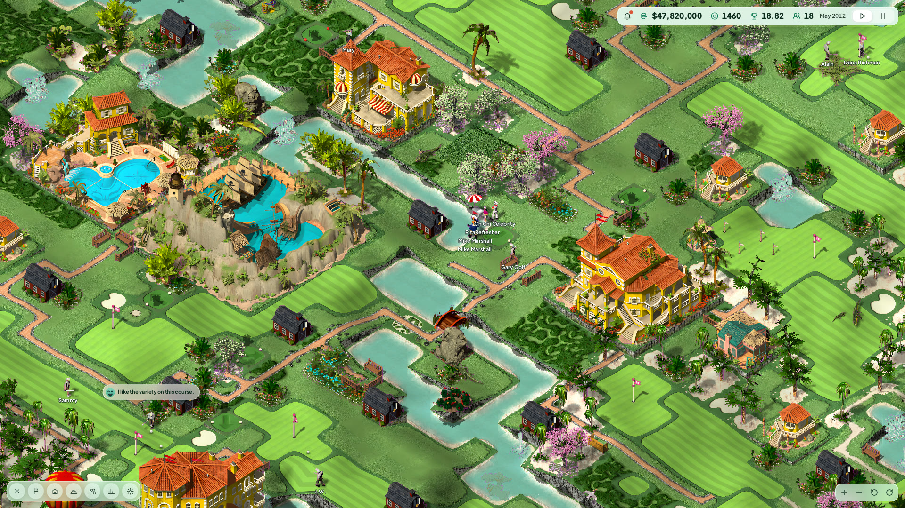
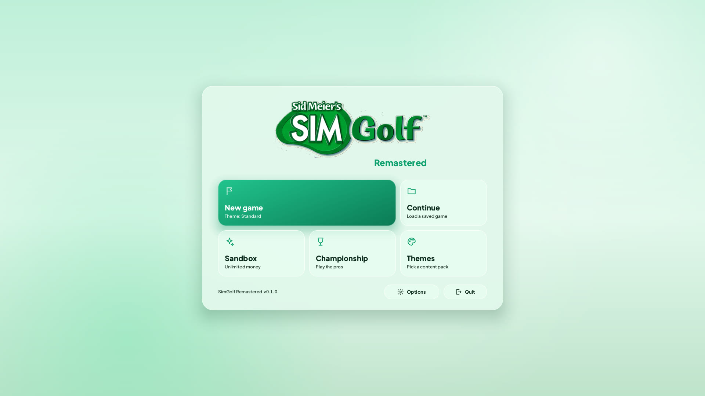
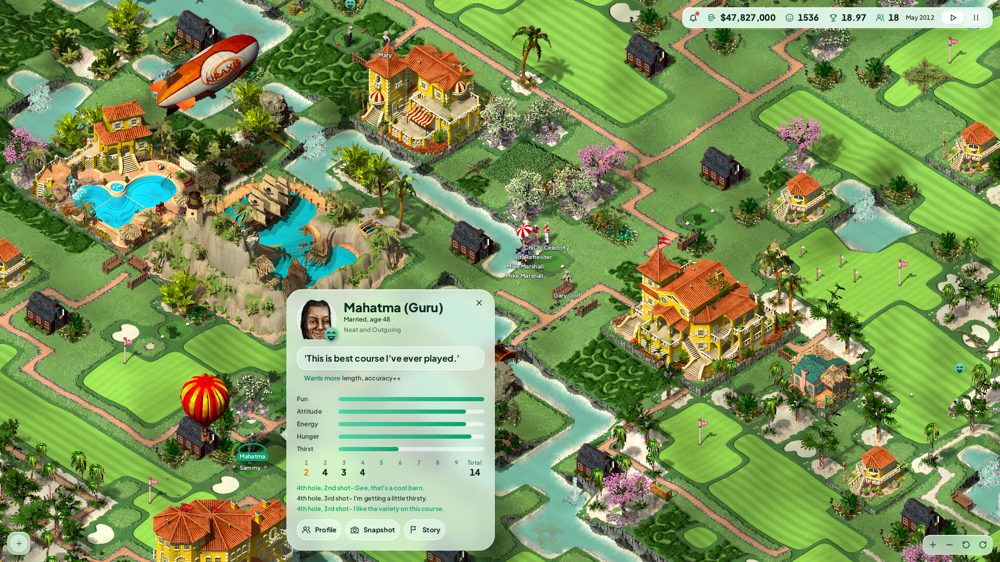
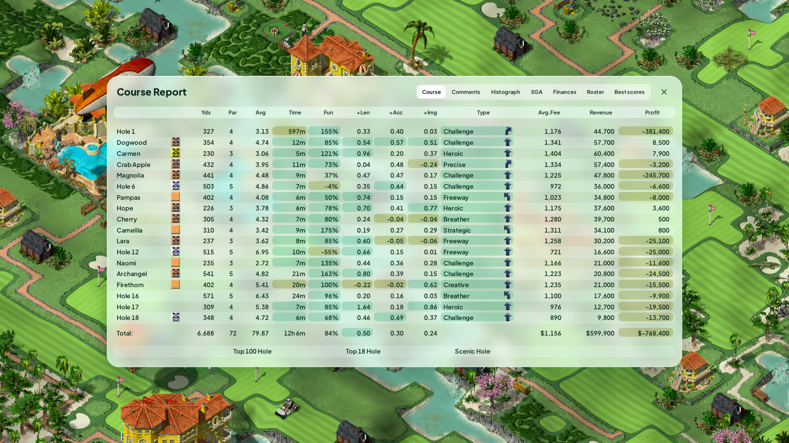
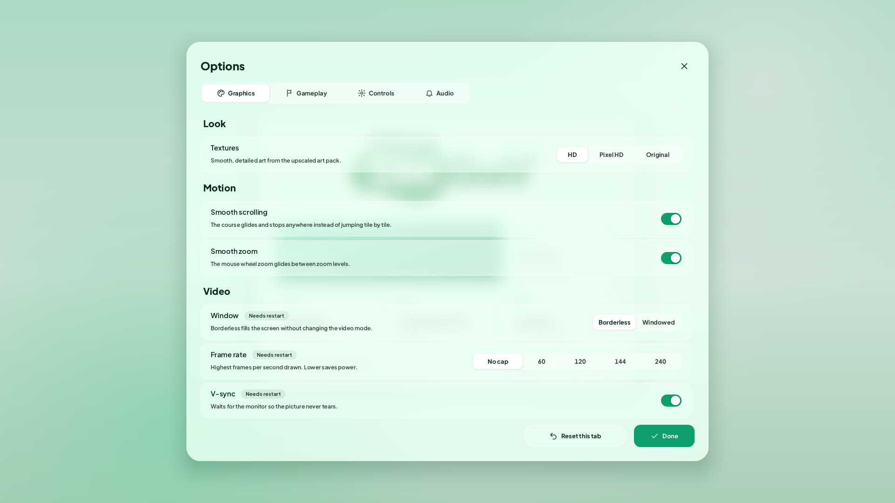

# SimGolf Remastered

A fan-made upgrade of **Sid Meier's SimGolf** (Firaxis / EA, 2002) for Windows PCs.
It runs your own copy of the game as a modern program: sharp at 1080p, 1440p
and 4K, widescreen, smooth scrolling and zoom, a cleaner look for the menus and
course HUD, an Options page, and a way to change the game with mods.

This download contains **no game files**. You bring your own copy of the game
(the disc image and the version 1.02 no-CD `golf.exe`); the installer unpacks
it on your PC and nothing from it ever leaves your computer.

| | |
|---|---|
|  |  |
|  |  |

## What you get

- Sharp, crisp picture at any screen size, borderless full screen, any frame rate
- Optional **HD art pack**: the game's own pictures upscaled 4x (a separate
  download of about 2.6 GB, offered by the installer)
- Smooth course scrolling, mouse-wheel zoom toward the pointer, W A S D and
  middle-mouse panning
- Frosted Mint menus, dialogs and course HUD, a round HD golf ball
- An Options page (graphics, gameplay speed, controls with key remapping, audio)
- Golfer names and speech bubbles you can switch on or off
- Mods: change prices, personalities and difficulty with small text files (see `docs/modding`)
- Every change can be switched off, so the original game is always one setting away

## Install in four steps

1. Get your game files (see [INSTALL.md](INSTALL.md) for exactly where):
   the SimGolf disc image and the v1.02 no-CD zip.
2. Download `SimGolf-Remastered-v*-windows.zip` from the
   [Releases page](../../releases) and unzip it (right-click, Extract All).
3. Double-click **Setup.cmd** and answer the questions. Say yes to the HD art
   if you have 3 GB free.
4. Play with the **SimGolf Remastered** shortcut on your desktop.

Full step-by-step help and fixes for common problems are in [INSTALL.md](INSTALL.md).

## Coming next

Being worked on now:
- **Realistic water:** moving waves, ripples that spread and bounce off the shore, rings where balls splash in, flowing streams, waterfall spray, sun glints
- **Pro golfer skills past 100%** once your course has 18 holes (up to 150%), as the original game intended
- **Path view:** see at a glance which buildings are joined to the clubhouse, with a marker on any that are not
- **Ball options:** smaller ball, every golfer's own ball colour, a smooth trail
- **The last old screens** redone: golfer profile editor, snapshot photos, land purchase map, Top 10 and leaderboards

Planned:
- **Weather:** sun, drifting cloud shadows, rain, storms that send golfers to shelter, morning fog, wind (look-only or with gentle effects on play)
- **Pause and speed buttons** on the HUD, and faster speeds that really hold up on big courses
- Faster loading, flat land that starts higher so you can dig down, placeable wetlands
- Animals you can buy and place, and a setting for how many wild animals appear
- Celebrities who buy homes and play your tournaments, AI-made golfers and stories, more languages

Ideas and help are welcome: see [CONTRIBUTING.md](CONTRIBUTING.md).

## Good to know

- Your saved games go in the `game\Saved Games` folder inside the install folder.
- To go back to the original look, open **Options** and pick Original textures,
  or edit `golf.ini` (the comments explain every line).
- Windows 10 or 11, 64-bit, a graphics card with OpenGL 3.3 or newer.

## Legal

This is an unofficial fan project. It is not affiliated with or endorsed by
Firaxis Games, Electronic Arts or Take-Two Interactive. SimGolf and its
assets are their property. This project distributes **none** of the game's
files: you supply your own copy. The optional HD art pack is a separate,
unofficial fan-made upscale of the game's own art; it is removed on request
by the rights holders.

The program code in this repository is MIT licensed ([LICENSE](LICENSE)).
It is built on [RichardAtCT/simgolf-web](https://github.com/RichardAtCT/simgolf-web)
(MIT), which translated the decompiled game into C. Third-party pieces keep
their own licences (see [CREDITS.md](CREDITS.md)).
